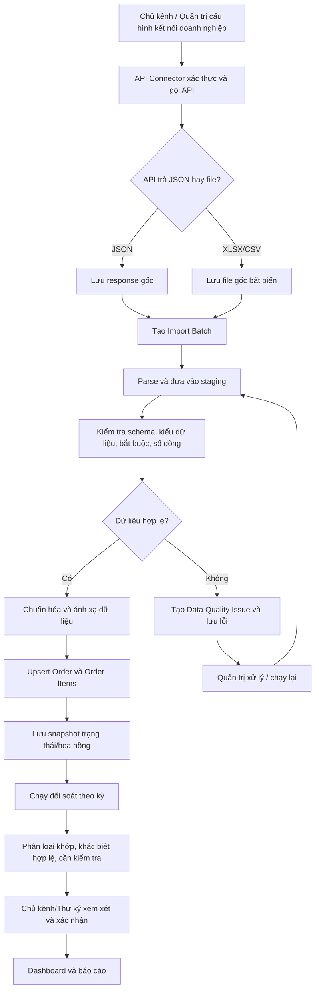
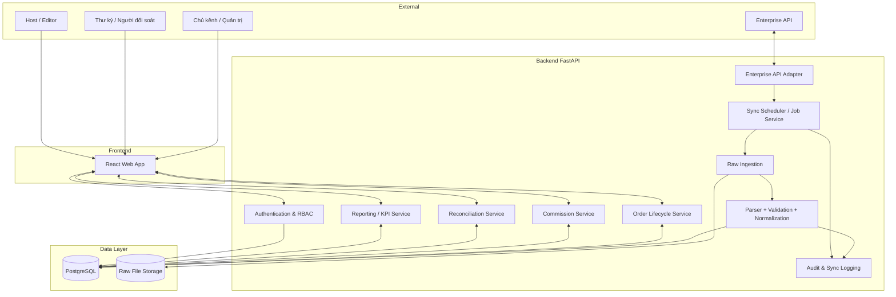
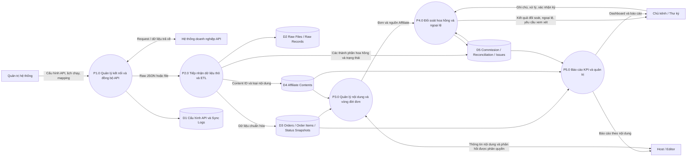
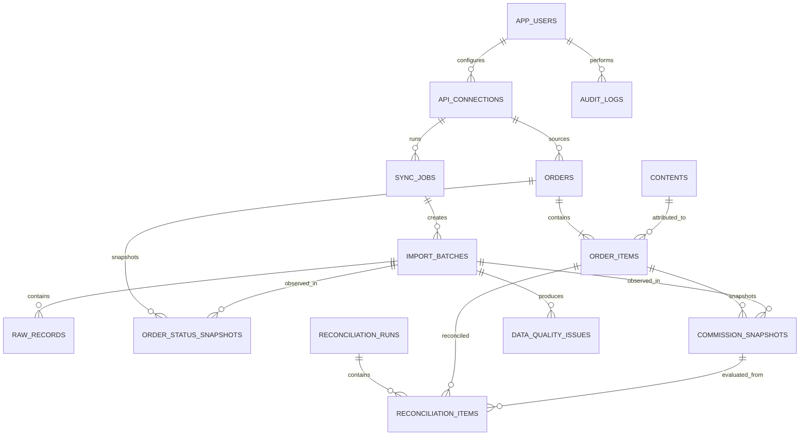

# Kiến trúc hệ thống MIS quản lý vòng đời đơn hàng và đối soát hoa hồng TikTok Affiliate

**Tổ chức:** Kênh TikTok Phúc Long Mart  
**Khung:** T08 – Bán hàng omnichannel và reconciliation  
**Tên giải pháp đề xuất:** Hệ thống MIS tiếp nhận dữ liệu Affiliate qua API, chuẩn hóa dữ liệu đơn hàng và hỗ trợ đối soát hoa hồng TikTok Affiliate.

---

## 1. Mục tiêu và phạm vi

### 1.1 Mục tiêu

Hệ thống nhận dữ liệu từ API do hệ thống doanh nghiệp cung cấp, lưu giữ bản dữ liệu gốc, chuẩn hóa dữ liệu theo mô hình thống nhất, theo dõi đơn hàng và trạng thái hoa hồng, sau đó tạo báo cáo đối soát/KPI phục vụ quyết định quản lý của chủ kênh.

Hệ thống phải hỗ trợ:

1. Kết nối API doanh nghiệp theo tài liệu và quyền truy cập được cấp.
2. Lấy dữ liệu dạng JSON hoặc tải file XLSX/CSV tùy hợp đồng API.
3. Lưu và cho tải lại file/response gốc của từng lần đồng bộ.
4. Chuẩn hóa, kiểm tra, chống trùng và lưu dữ liệu vào PostgreSQL.
5. Quản lý đơn ở cấp đơn hàng và chi tiết SKU.
6. Tách trạng thái thanh toán/giao nhận/hoàn trả khỏi trạng thái quyết toán hoa hồng.
7. So sánh các thành phần hoa hồng ước tính với hoa hồng thực tế do nguồn TikTok/doanh nghiệp trả về; giải thích các khác biệt có căn cứ.
8. Báo cáo số đơn đã đặt, đã thanh toán, đã giao/khách nhận, hủy, hoàn trả và đã quyết toán hoa hồng theo tỷ lệ trên tổng đơn đặt.
9. Lưu dấu vết đồng bộ, dữ liệu nguồn, người xử lý và lịch sử phê duyệt.

### 1.2 Ngoài phạm vi

- Không đối chiếu hoa hồng với sao kê ngân hàng.
- Không quản lý giao dịch ngân hàng, tài khoản ngân hàng hoặc xác nhận tiền thực vào ngân hàng.
- Không tự chuyển tiền cho Affiliate/KOC.
- Không tự xác nhận hoặc sửa trạng thái trên TikTok.
- Không xây nền tảng đăng video, livestream hoặc sàn thương mại điện tử.
- Không tự suy luận đơn đã giao/hủy/đã thanh toán nếu API không cung cấp trường hoặc endpoint xác nhận.

Có thể giữ màn hình quản lý nội dung ở mức danh mục Video/Live/Showcase và phân tích hiệu quả theo nguồn đơn. Không mở rộng thành hệ thống quản lý lịch sản xuất nội dung nếu doanh nghiệp chưa yêu cầu.

---

## 2. Căn cứ dữ liệu và nhận định từ tài liệu đầu vào

### 2.1 Workbook Affiliate Orders

Workbook được gửi có 48 cột, 2.107 dòng dữ liệu chi tiết và 2.078 `ID đơn hàng` duy nhất. Một đơn có thể có nhiều dòng SKU; vì vậy:

- Đếm số đơn: `COUNT(DISTINCT ID đơn hàng)`.
- Đếm dòng sản phẩm/chi tiết: đếm bản ghi theo `ID đơn hàng + ID SKU` hoặc khóa dòng được API cung cấp.
- Không dùng số dòng Excel làm tổng số đơn.

Trong file mẫu, loại nội dung gồm `Video`, `Live`, `Trang trưng bày`. Trường `Loại đơn hàng` là một phân loại khác, ví dụ `Đơn hàng quảng cáo cửa hàng` và `Đơn hàng liên kết`; không gộp hai trường này.

Trường `Trạng thái quyết toán đơn hàng` có các giá trị đang thấy trong file: `Đã quyết toán`, `Chờ xử lý`, `Không đủ điều kiện`, `AwaitingPayment`. Phải lưu cả giá trị nguồn và giá trị chuẩn hóa. Không tự coi `Không đủ điều kiện` là đơn hủy, vì đây là trạng thái quyết toán/đủ điều kiện hoa hồng, không phải bằng chứng duy nhất về trạng thái logistics.

Các trường `Số món bán ra`, `Số món đã hoàn tiền`, `Ngày đặt hàng`, `Ngày quyết toán hoa hồng`, các trường hoa hồng ước tính, hoa hồng thực tế và `Tổng số tiền nhận được cuối cùng` là dữ liệu quan trọng của ETL.

### 2.2 Khoảng trống dữ liệu phải xử lý trước khi chốt KPI

Workbook hiện tại không có trường riêng, rõ ràng cho:

- Trạng thái thanh toán đơn của người mua (Paid/Unpaid) ngoài giá trị nguồn `AwaitingPayment` cần được doanh nghiệp xác nhận nghĩa.
- Trạng thái giao nhận như Shipped/Delivered/Received.
- Trạng thái hủy riêng (Cancelled) và thời điểm hủy.
- Mã/trạng thái/giá trị hoàn tiền chi tiết đầy đủ, ngoài số món đã hoàn tiền.

Do đó, API doanh nghiệp phải cung cấp thêm các trường trên hoặc một endpoint order-lifecycle/refund riêng. Nếu chưa có, dashboard phải hiển thị `Chưa có dữ liệu nguồn` thay vì tự suy ra.

### 2.3 Giao diện HTML hiện có

`index.html` là prototype giao diện đơn trang; dữ liệu hiện đang khai báo trong các mảng JavaScript và giữ trong bộ nhớ trình duyệt. Có thể tái sử dụng màu sắc, sidebar, bảng, modal và bố cục dashboard làm tham khảo UI.

Cần bỏ toàn bộ chức năng/ngôn ngữ liên quan tới:

- Import sao kê ngân hàng.
- Đối chiếu với `paid`/tiền thực nhận ngân hàng.
- Mã giao dịch ngân hàng và minh chứng sao kê.
- KPI “tỷ lệ khớp tiền ngân hàng”.

Thay thế bằng API Sync, Raw Data Batch, ETL/Validation, trạng thái vòng đời đơn, trạng thái hoa hồng và báo cáo theo dữ liệu TikTok.

---

## 3. Quy trình nghiệp vụ TO-BE



### 3.1 Các bước chi tiết

1. **Cấu hình kết nối:** khai báo môi trường, loại xác thực, scopes và lịch đồng bộ theo API contract.
2. **Gọi API:** gọi endpoint thực tế theo tài liệu doanh nghiệp; xử lý phân trang, rate limit, timeout, retry.
3. **Lưu dữ liệu gốc:** lưu nguyên response JSON hoặc binary XLSX/CSV, checksum SHA-256, tên file, thời gian gọi, request/correlation ID và phiên bản schema.
4. **Staging:** parse dữ liệu vào vùng staging; không ghi thẳng file nguồn vào bảng nghiệp vụ.
5. **Validation:** kiểm tra cột bắt buộc, ID, kiểu dữ liệu, ngày, tiền tệ, phần trăm, dòng rỗng, trùng lặp.
6. **Normalization:** chuyển dữ liệu nguồn thành cấu trúc chuẩn, nhưng giữ nguyên raw value và raw payload.
7. **Upsert:** cập nhật đơn và item theo khóa nguồn; đồng bộ lại cùng một bản ghi không được tạo đơn trùng.
8. **Snapshot:** lưu trạng thái đơn và trạng thái hoa hồng theo từng lần quan sát/đồng bộ để có thể truy vết biến động.
9. **Reconciliation:** so sánh các thành phần hoa hồng cùng cơ sở tính; phân loại điều chỉnh do hoàn/hủy, chưa quyết toán, thuế, thưởng, chia sẻ hoặc chưa rõ nguyên nhân.
10. **Report:** tính KPI theo cohort ngày đặt đơn và hiển thị thời điểm dữ liệu được đồng bộ gần nhất.

---

## 4. Kiến trúc logic



### 4.1 Các lớp

| Lớp | Thành phần | Trách nhiệm |
|---|---|---|
| Presentation | React + TypeScript | Màn hình, bộ lọc, bảng, biểu đồ, tải file |
| API | FastAPI | REST endpoints, xác thực, validation request |
| Integration | Enterprise Connector | Giao tiếp API doanh nghiệp; không đặt logic nghiệp vụ trong UI |
| Ingestion | Raw Batch Service | Lưu response/file gốc và metadata |
| ETL | Parser, Validator, Mapper | Parse XLSX/CSV/JSON, chuẩn hóa, chống trùng |
| Domain | Orders, Commissions, Reconciliation | Quy tắc đơn hàng và hoa hồng |
| Reporting | KPI/Report Service | Tính số đơn và tỷ lệ theo thời gian/nguồn/nội dung |
| Persistence | PostgreSQL | Dữ liệu nghiệp vụ và lịch sử |
| Raw storage | Docker volume ở demo | Lưu file gốc, không thay thế database |
| Observability | Sync logs, Audit logs | Theo dõi lần gọi, lỗi, ai thao tác |

### 4.2 Tech stack đề xuất

- Frontend: React, TypeScript, Vite.
- Backend: Python 3.12, FastAPI, Pydantic.
- Database: PostgreSQL 16 (bắt buộc không dùng SQLite).
- ORM/migration: SQLAlchemy 2, Alembic.
- Excel: parser phía backend, hỗ trợ XLSX/CSV; không xử lý file lớn trong trình duyệt.
- Scheduler: APScheduler cho demo; có thể nâng cấp worker/queue sau.
- Test: Pytest cho backend; Playwright hoặc test thủ công có checklist cho UI.
- Local: Docker Compose.

---

## 5. Thiết kế dữ liệu chuẩn hóa

### 5.1 Nguyên tắc

1. Mã TikTok như Order ID, SKU ID, Product ID, Content ID phải lưu dạng `VARCHAR`, không chuyển sang JavaScript Number hoặc kiểu số có thể làm mất độ chính xác.
2. Một `orders` là một đơn; `order_items` là nhiều dòng SKU thuộc đơn.
3. Tiền lưu kiểu `NUMERIC`, không dùng FLOAT để tính toán tiền.
4. Tỷ lệ lưu dạng số phần trăm rõ đơn vị, ví dụ `5.0000` nghĩa là 5%.
5. Lưu raw status và normalized status song song.
6. Lưu `source_batch_id`, `source_row_number`, `source_updated_at`, `observed_at` để truy nguồn.
7. Không xóa snapshot cũ khi có lần đồng bộ mới.

### 5.2 Các thực thể chính

| Bảng | Ý nghĩa |
|---|---|
| `users` | Người dùng và vai trò |
| `api_connections` | Metadata kết nối API; không lưu secret dạng rõ |
| `sync_jobs` | Mỗi lần gọi/đồng bộ |
| `import_batches` | Một file/response gốc được tiếp nhận |
| `raw_records` | Dòng JSON gốc hoặc dữ liệu mỗi hàng XLSX |
| `contents` | Video, Live, Showcase và mã nội dung |
| `orders` | Header đơn hàng, một bản ghi mỗi Order ID |
| `order_items` | Dòng sản phẩm/SKU |
| `order_status_snapshots` | Trạng thái payment/fulfillment/refund theo từng lần đồng bộ |
| `commission_snapshots` | Dữ liệu hoa hồng ước tính/thực tế/settlement theo item và batch |
| `reconciliation_runs` | Một lần đối soát theo kỳ |
| `reconciliation_items` | Kết quả đối soát từng item/đơn |
| `data_quality_issues` | Dữ liệu thiếu, sai format, unknown status, duplicate conflict |
| `audit_logs` | Nhật ký người dùng và thao tác quan trọng |

### 5.3 Tách 3 nhóm trạng thái

**A. Payment status – thanh toán của người mua**

`UNPAID`, `PAID`, `PARTIALLY_PAID`, `UNKNOWN` (chỉ dùng các trạng thái API thực tế cung cấp).

**B. Fulfillment/order status – xử lý và giao nhận**

`NEW`, `PROCESSING`, `SHIPPED`, `DELIVERED`, `CANCELLED`, `RETURN_REQUESTED`, `RETURNED`, `UNKNOWN`.

**C. Commission settlement status – quyết toán hoa hồng**

Chuẩn hóa các raw status đã thấy trong file mẫu:

| Giá trị nguồn | Giá trị nội bộ đề xuất | Ghi chú |
|---|---|---|
| `Đã quyết toán` | `SETTLED` | Hoa hồng đã quyết toán theo nguồn |
| `Chờ xử lý` | `PENDING` | Chưa hoàn tất quyết toán |
| `Không đủ điều kiện` | `INELIGIBLE` | Không đủ điều kiện nhận commission; không suy ra là đơn hủy |
| `AwaitingPayment` | `AWAITING_PAYMENT` | Giữ nguyên và xác minh nghĩa từ doanh nghiệp/API contract trước khi diễn giải KPI thanh toán |
| giá trị khác | `UNKNOWN` | Lưu raw value và tạo cảnh báo mapping |

Không dùng một cột trạng thái duy nhất để đại diện cho cả thanh toán, giao hàng, hoàn trả và quyết toán hoa hồng.

---

## 6. ETL và quy tắc chuẩn hóa workbook

### 6.1 Input support

Connector phải hỗ trợ một trong hai loại response, dựa trên API contract:

- `JSON`: response phân trang; lưu nguyên JSON và parse các bản ghi.
- `FILE`: API trả về link hoặc binary XLSX/CSV; tải file về vùng raw storage, sau đó parse trên backend.

Không giả định API luôn trả XLSX. Không hardcode endpoint hoặc trường request khi chưa được doanh nghiệp cung cấp tài liệu.

### 6.2 Quy tắc parse cụ thể từ workbook mẫu

- `ID đơn hàng`, `ID SKU`, `ID sản phẩm`, `Mã cửa hàng`, `Id nội dung`: string.
- `Số món bán ra`, `Số món đã hoàn tiền`: integer không âm.
- Trường tiền VND có thể được hiển thị như `248.399`; theo định dạng mẫu đây là 248.399 đồng theo dấu phân tách hàng nghìn Việt Nam, phải parse thành 248399, không phải 248.399 đồng. Parser phải cấu hình locale và log dòng không parse được.
- Trường phần trăm như `5%`, `10%`: parse thành 5 và 10 trong cột `*_percent`.
- `/`, ô trống: lưu NULL nếu là dữ liệu không có; chỉ chuyển thành 0 khi business rule xác nhận trường đó mang ý nghĩa số 0.
- Ngày dạng `dd/MM/yyyy HH:mm:ss`: parse theo `Asia/Ho_Chi_Minh`, giữ giá trị gốc và thời gian chuẩn hóa.
- `VND`: lưu currency code; không trộn với loại tiền khác khi tổng hợp.
- `Loại nội dung`: `Video` → `VIDEO`; `Live` → `LIVE`; `Trang trưng bày` → `SHOWCASE`.
- `Loại đơn hàng`: giữ riêng như dữ liệu nguồn, không dùng thay `Loại nội dung`.

### 6.3 Khóa chống trùng

- Order: `(integration_id, external_order_id)`.
- Order item: ưu tiên `external_order_item_id` nếu API cung cấp; nếu không, dùng khóa ghép `(order_id, external_sku_id, external_product_id)` theo khả năng dữ liệu thực tế.
- Raw record: `(import_batch_id, source_row_number)`.
- Commission snapshot: `(order_item_id, import_batch_id)`.

Nếu một batch chạy lại, phải idempotent: không tạo thêm đơn/item trùng; chỉ thêm snapshot mới khi thực sự là một lần quan sát mới.

### 6.4 Xử lý lỗi

- API timeout/5xx/rate limit: retry có backoff và ghi log.
- 401/403: đánh dấu authorization issue; không retry vô hạn.
- Pagination: tiếp tục tới hết cursor/page; lưu cursor checkpoint nếu API hỗ trợ.
- Schema thay đổi: dừng import hoặc cách ly batch, không âm thầm bỏ cột.
- Unknown status: lưu raw, đánh dấu cần mapping.
- Một số hàng lỗi: lưu `data_quality_issues`, cho phép tải file lỗi; không làm mất file gốc.

---

## 7. Định nghĩa KPI và báo cáo

### 7.1 Mẫu số và phạm vi thời gian

Mặc định báo cáo theo **ngày đặt hàng** (`order_created_at`) trong múi giờ `Asia/Ho_Chi_Minh`.

`Total Orders Placed = COUNT(DISTINCT external_order_id)` trong cohort ngày đặt được chọn.

Mỗi KPI trạng thái là số Order ID duy nhất trong cohort đang có trạng thái tương ứng chia cho tổng đơn đặt. Một order có thể đã thanh toán, đã giao và sau đó hoa hồng được quyết toán; vì thế các tỷ lệ mốc trạng thái có thể chồng lấp và **không cộng lại thành 100%**.

### 7.2 KPI cần có

| KPI | Cách tính | Nguồn bắt buộc |
|---|---|---|
| Tổng đơn đã đặt | distinct order_id | Affiliate orders API/file |
| Đơn đã thanh toán | distinct order_id có payment_status = PAID | API order lifecycle/payment |
| Tỷ lệ đã thanh toán | Paid Orders / Total Orders Placed × 100 | như trên |
| Đơn khách đã nhận | distinct order_id có fulfillment_status = DELIVERED/RECEIVED | API fulfillment/order lifecycle |
| Tỷ lệ khách đã nhận | Delivered Orders / Total Orders Placed × 100 | như trên |
| Đơn đã hủy | distinct order_id có order_status = CANCELLED | API order lifecycle |
| Tỷ lệ hủy | Cancelled Orders / Total Orders Placed × 100 | như trên |
| Đơn hoàn trả | distinct order_id có refund status hoặc refunded_qty > 0 | API refund; file mẫu có refunded qty |
| Tỷ lệ hoàn trả | Refunded Orders / Total Orders Placed × 100 | như trên |
| Đơn đã quyết toán hoa hồng | distinct order_id mà toàn bộ order items đã SETTLED | Affiliate commission data |
| Tỷ lệ quyết toán | Settled Orders / Total Orders Placed × 100 | Affiliate commission data |
| Hoa hồng cuối cùng theo TikTok | sum `Tổng số tiền nhận được cuối cùng` hoặc trường tương đương | Affiliate commission data |
| Hoa hồng còn chờ | sum estimated/eligible pending amount theo định nghĩa đã xác nhận | Affiliate commission data |

**Không được gọi `Tổng số tiền nhận được cuối cùng` là tiền ngân hàng thực nhận.** Đây là giá trị theo báo cáo Affiliate nguồn, không có nghĩa hệ thống đã xác minh giao dịch ngân hàng.

### 7.3 Quy tắc tổng hợp nhiều SKU

Một order có thể có nhiều order items. Đối với KPI đếm đơn:

- `SETTLED` order: tất cả order items của đơn đều có trạng thái commission `SETTLED`.
- `PARTIALLY_SETTLED` order: có ít nhất một item đã settled và còn item chưa settled.
- `PENDING` order: có item pending nhưng chưa có item settled (hoặc quy tắc khác do doanh nghiệp xác nhận).
- `INELIGIBLE` order: phải phân loại theo item và không mặc định toàn đơn bị hủy.

Báo cáo chi tiết hoa hồng nên thể hiện cả số liệu item-level và order-level.

### 7.4 Đối soát hoa hồng – không có ngân hàng

Đối soát trong phạm vi này là kiểm tra tính nhất quán giữa:

1. Thành phần hoa hồng ước tính do nguồn trả về.
2. Thành phần hoa hồng thực tế do nguồn trả về.
3. Cơ sở hoa hồng thực tế, số lượng đã hoàn, trạng thái quyết toán.
4. Giá trị tổng hoa hồng cuối cùng theo nguồn TikTok/doanh nghiệp.

Không so sánh với sao kê ngân hàng.

Không lấy `estimated gross commission` trừ trực tiếp `final net commission` rồi kết luận đó là sai lệch tài chính, vì final net có thể đã tính thuế, chia sẻ đối tác và các khoản thưởng/điều chỉnh. So sánh cùng loại thành phần với nhau; nếu nguồn chỉ cung cấp tổng estimate và final net, phải đặt nhãn `Chênh lệch estimate–final, cần giải thích`, không tự động gắn là lỗi.

Mã nguyên nhân gợi ý:

- `REFUND_ADJUSTMENT`
- `CANCELLED_OR_INELIGIBLE`
- `PENDING_SETTLEMENT`
- `TAX_OR_WITHHOLDING`
- `BONUS_OR_REVENUE_SHARE`
- `MISSING_SOURCE_FIELD`
- `UNKNOWN_STATUS`
- `UNEXPLAINED_DIFFERENCE`

---

## 8. Các màn hình web

### 8.1 Điều hướng chính

1. **Tổng quan:** KPI đơn đặt, paid, delivered, cancelled, refunded, settled commission; bộ lọc kỳ; thời điểm đồng bộ gần nhất.
2. **Kết nối API:** trạng thái kết nối, thông tin phạm vi quyền (không lộ secret), kiểm tra kết nối, cấu hình lịch đồng bộ.
3. **Lịch sử đồng bộ & dữ liệu thô:** danh sách batch, số dòng, số mới/cập nhật/trùng/lỗi, thời gian, tải raw XLSX/CSV/JSON.
4. **Dữ liệu đã chuẩn hóa:** tra cứu order và order items, trạng thái, nguồn content, số lượng hoàn, commission status.
5. **Đối soát hoa hồng:** chọn kỳ; xem estimate vs actual theo thành phần; xem final commission theo nguồn; đánh dấu khác biệt cần kiểm tra.
6. **Ngoại lệ dữ liệu:** unknown status, thiếu field, lỗi parse, item trùng, khác biệt chưa giải thích; gán người xử lý và ghi chú.
7. **Nội dung Affiliate:** lọc theo Video/Live/Showcase và Content ID; thống kê đơn/hoa hồng.
8. **Báo cáo quản trị:** KPI theo kỳ, loại nội dung, sản phẩm, cửa hàng, trạng thái hoa hồng; xuất XLSX/CSV.
9. **Quản trị người dùng:** vai trò và quyền.

### 8.2 Wireframe dạng text cho Dashboard

```text
[Logo Phúc Long Mart]  Tổng quan | API & Đồng bộ | Đơn hàng | Đối soát | Ngoại lệ | Nội dung | Báo cáo

Kỳ báo cáo: [Từ ngày] [Đến ngày]  Cơ sở ngày: [Ngày đặt hàng v]  [Làm mới]
API status: Connected/Not connected | Last sync: ... | [Đồng bộ ngay]

[Đơn đã đặt] [Đã thanh toán] [Khách đã nhận] [Đã hủy] [Đã hoàn] [Đã quyết toán HH]

Biểu đồ 1: Funnel/milestone status (tỷ lệ trên tổng đơn đặt; ghi rõ các tỷ lệ có thể chồng lấp)
Biểu đồ 2: Hoa hồng ước tính vs thực tế theo ngày/tháng (cùng đơn vị thành phần)
Biểu đồ 3: Đơn và hoa hồng theo Video / Live / Showcase

Bảng: Kỳ | Tổng đơn | Paid % | Delivered % | Cancel % | Refund % | Settled commission % | Final commission
Danh sách cần xem: Pending, Unknown status, Missing fields, Unexplained differences
```

---

## 9. API nghiệp vụ nội bộ của MIS

Đây là API do nhóm xây cho frontend gọi; khác với endpoint của doanh nghiệp.

| Method | MIS endpoint | Mục đích |
|---|---|---|
| GET | `/api/v1/integrations/enterprise/status` | Trạng thái kết nối |
| POST | `/api/v1/integrations/enterprise/test` | Kiểm tra kết nối (không lộ credentials) |
| POST | `/api/v1/sync-jobs` | Tạo yêu cầu đồng bộ |
| GET | `/api/v1/sync-jobs` | Danh sách lần đồng bộ |
| GET | `/api/v1/sync-jobs/{id}` | Chi tiết batch/job |
| GET | `/api/v1/import-batches/{id}/raw-file` | Tải file gốc |
| GET | `/api/v1/import-batches/{id}/issues` | Lỗi kiểm tra dữ liệu |
| GET | `/api/v1/orders` | Tìm kiếm/lọc đơn |
| GET | `/api/v1/orders/{id}` | Chi tiết đơn và SKU |
| GET | `/api/v1/reconciliation/runs` | Danh sách kỳ/lần đối soát |
| POST | `/api/v1/reconciliation/runs` | Tạo lần đối soát |
| GET | `/api/v1/reconciliation/runs/{id}` | Kết quả đối soát |
| GET | `/api/v1/reports/order-kpis` | KPI đơn hàng theo cohort |
| GET | `/api/v1/reports/commission` | Báo cáo hoa hồng |
| GET | `/api/v1/reports/content-performance` | Báo cáo theo loại nội dung/content ID |
| GET | `/api/v1/data-quality/issues` | Ngoại lệ dữ liệu |

---

## 10. Security, audit và vận hành

- API key/secret/access token không để trong frontend, GitHub, log hoặc file `.env` đã commit.
- `.env` chỉ ở máy local; repo chỉ có `.env.example` với placeholder.
- Nếu cần lưu refresh token, mã hóa khi lưu; giới hạn người/tiến trình có thể truy cập.
- Dùng RBAC tối thiểu: `ADMIN`, `OWNER`, `OPS`, `HOST`, `EDITOR`, `VIEWER`.
- Ghi audit log cho cấu hình API, đồng bộ, mapping status, sửa dữ liệu thủ công, phê duyệt/chốt kỳ.
- Không sửa raw payload. Mọi thao tác hiệu chỉnh dữ liệu chuẩn hóa phải ghi ai sửa, lúc nào, giá trị trước/sau và lý do.
- Che thông tin người mua và trường dữ liệu không cần cho nghiệp vụ; áp dụng thời hạn lưu giữ do doanh nghiệp xác nhận.
- Demo phải dùng mock data; không chép dữ liệu thật trong workbook doanh nghiệp sang seed database.
- Có backup PostgreSQL và raw storage; có quy trình chạy lại một batch.

---

## 11. Tiêu chí nghiệm thu kỹ thuật

1. Kết nối Mock Connector chạy được khi chưa có API thật.
2. API Connector thật chỉ bật khi có tài liệu endpoint/auth/schema từ doanh nghiệp.
3. Có thể nhận JSON hoặc file theo loại được cấu hình.
4. Raw artifact tải xuống được và không bị sửa sau khi lưu.
5. 2.107 dòng giả lập tương tự cấu trúc Excel có thể được parse; số Order ID được đếm distinct, không phải 2.107 đơn.
6. Nhập lại cùng batch không sinh bản ghi trùng.
7. Dòng nhiều SKU được lưu thành nhiều `order_items` dưới cùng một order.
8. Số tiền VND `248.399` được parse thành `248399` theo locale đã cấu hình; lỗi format phải cách ly và cảnh báo.
9. Status raw luôn được lưu; unknown status không được tự đổi thành Delivered/Completed.
10. KPI paid/delivered/cancelled/refunded chỉ tính khi có nguồn tương ứng; thiếu nguồn phải hiển thị N/A hoặc `Chưa có dữ liệu`.
11. Commission settled được tính riêng với order delivered và payment paid.
12. Không còn màn hình, bảng, API hoặc KPI đối chiếu sao kê ngân hàng.
13. CRUD tối thiểu chạy với PostgreSQL; báo cáo đọc từ dữ liệu đã lưu.
14. Có unit/integration test cho parse tiền/ngày, dedup, multi-SKU, status mapping, KPI và reconciliation.

---

## 12. Kế hoạch triển khai theo thứ tự

### Sprint/Phase A – Xác nhận API Contract

- Lấy API documentation, base URL môi trường test, auth method, scopes, endpoints, pagination, rate limits, sample response/file.
- Xác nhận API có order lifecycle (payment/delivery/cancel/refund) hay chỉ affiliate commission report.
- Xác nhận định nghĩa `AwaitingPayment` và `Không đủ điều kiện`.

### Sprint/Phase B – Data model và ETL

- Tạo PostgreSQL schema.
- Dựng Mock Connector và file fixture giả lập.
- Dựng raw batch, parser, validation, normalization, dedup/upsert.
- Tạo màn hình sync history và raw download.

### Sprint/Phase C – Nghiệp vụ

- Quản lý orders/order items.
- Trạng thái payment/fulfillment/refund/commission riêng biệt.
- Commission snapshots và đối soát estimate/actual cùng cơ sở.
- Quản lý ngoại lệ.

### Sprint/Phase D – Dashboard, export, kiểm thử

- KPI theo order-created cohort.
- Breakdown theo content type/video/live/showcase.
- Export báo cáo CSV/XLSX.
- Kiểm thử edge cases và user validation.

### Sprint/Phase E – API thật

- Thay Mock Connector bằng Enterprise API Adapter dựa trên contract đã xác nhận.
- Không thay đổi domain service/DB nếu mapping contract đã được thiết kế đúng.
- Chạy đối chiếu song song với file mẫu đã được phép sử dụng, không dùng bank statement.

---

## 13. Quyết định thiết kế cần doanh nghiệp xác nhận

| ID | Câu hỏi cần xác nhận | Tại sao quan trọng |
|---|---|---|
| DEC-01 | API trả JSON, file XLSX/CSV hay link tải file? | Quyết định connector và parser |
| DEC-02 | API có endpoint riêng cho trạng thái thanh toán không? | Cần cho KPI Paid |
| DEC-03 | API có trạng thái giao hàng/đã nhận không? | Cần cho KPI Delivered |
| DEC-04 | API có trạng thái hủy và thời điểm hủy không? | Cần cho KPI Cancelled |
| DEC-05 | API có refund status/amount/qty theo SKU không? | Cần cho KPI Refund |
| DEC-06 | `AwaitingPayment` trong file hiện tại có nghĩa chính xác là gì? | Tránh nhầm payment status và commission status |
| DEC-07 | `Không đủ điều kiện` bao gồm các nguyên nhân nào? | Không nhầm thành cancelled/refunded |
| DEC-08 | Các thành phần estimate/actual/final commission có quy tắc tính ra sao? | Đối soát cùng cơ sở |
| DEC-09 | API có `updated_at`, cursor hoặc incremental sync không? | Tránh bỏ sót status thay đổi |
| DEC-10 | Cho phép giữ raw file bao lâu và ai được tải? | Quyền riêng tư và lưu trữ |

**Kết luận kiến trúc:** Xây hệ thống theo mô hình `API Connector → Raw Storage → ETL/Staging → PostgreSQL Canonical Data → Reconciliation → KPI/Reports`. Dùng adapter và mock mode để phát triển trước; chỉ cấu hình connector thật sau khi doanh nghiệp cung cấp API contract. Không đưa đối chiếu ngân hàng vào phạm vi.

## 4.3 DFD Level 0 đề xuất sau khi bỏ đối chiếu ngân hàng

**Tác nhân ngoài**

- `E1 – Hệ thống doanh nghiệp API`: cung cấp file/report hoặc dữ liệu Affiliate/order lifecycle.
- `E2 – Quản trị hệ thống`: cấu hình kết nối, lịch đồng bộ, mapping.
- `E3 – Chủ kênh/Thư ký`: theo dõi kết quả, xử lý ngoại lệ, xác nhận kỳ đối soát.
- `E4 – Host/Editor`: xem số liệu theo nội dung phụ trách và phản hồi thông tin nguồn nội dung nếu được phân quyền.

**Tiến trình**

- `P1.0 – Quản lý kết nối và đồng bộ API`.
- `P2.0 – Tiếp nhận dữ liệu thô, ETL, chuẩn hóa và kiểm tra`.
- `P3.0 – Quản lý nội dung và vòng đời đơn hàng`.
- `P4.0 – Đối soát hoa hồng và xử lý ngoại lệ`.
- `P5.0 – Báo cáo KPI và quản trị`.

**Kho dữ liệu**

- `D1 – Cấu hình kết nối và nhật ký đồng bộ`.
- `D2 – File/response thô và raw records`.
- `D3 – Đơn hàng, chi tiết SKU và snapshot trạng thái`.
- `D4 – Nội dung Affiliate (Video/Live/Showcase)`.
- `D5 – Snapshot hoa hồng, kỳ đối soát và ngoại lệ`.



**Điểm khác với DFD cũ:** bỏ thực thể ngân hàng, kho giao dịch ngân hàng, luồng yêu cầu thanh toán qua ngân hàng và tiến trình so khớp tiền nhận. Tiến trình `P4.0` cũ về xử lý chi trả được thay bằng báo cáo KPI; nếu sau này doanh nghiệp cần phân bổ hoa hồng nội bộ thì đó là change request riêng, không thuộc phạm vi hiện tại.

## 5.4 Logical ERD đề xuất



### Điều chỉnh trực tiếp so với ERD người dùng gửi

| Thành phần ERD hiện tại | Đề xuất |
|---|---|
| `Don_Hang_Tiktok` chứa cả mã đơn và SKU | Tách `orders` (header) và `order_items` (SKU detail); file Excel chứng minh một Order ID có thể có nhiều dòng SKU |
| `Giao_dich_ngan_hang` | Xóa khỏi phạm vi và schema |
| `Doi_soat_hoa_hong.So_tien_thuc_nhan` | Không dùng tên này; thay bằng `final_commission_amount_source` lấy từ báo cáo Affiliate, không phải tiền ngân hàng |
| `Nhat_ky_dong_bo_API` gắn với phiên livestream | Tách `sync_jobs/import_batches` thành luồng kỹ thuật độc lập; batch có thể chứa nhiều orders, không phụ thuộc phiên Live |
| `Noi_dung_Video` và `Phien_livestream` riêng | Tạo `contents` chung với `content_type` VIDEO/LIVE/SHOWCASE; mở rộng bảng chi tiết nếu Live cần trường riêng |
| Chưa có lịch sử trạng thái đơn | Thêm `order_status_snapshots` để lưu payment/fulfillment/refund theo từng lần đồng bộ |
| Chưa có snapshot hoa hồng | Thêm `commission_snapshots` để lưu estimate/actual/status theo batch, không ghi đè lịch sử |
| `Nhat_ky_sai_lech` có chứng từ ngân hàng | Đổi thành `data_quality_issues` và `reconciliation_items`; minh chứng chỉ là dữ liệu nguồn/đính kèm được phép, không phải sao kê ngân hàng |

## 8.3 Functional Decomposition (FDD) cập nhật

```mermaid
flowchart TD
  ROOT[Hệ thống MIS quản lý đơn hàng và đối soát hoa hồng Affiliate]
  ROOT --> A[1. Quản lý kết nối API]
  ROOT --> B[2. Tiếp nhận và chuẩn hóa dữ liệu]
  ROOT --> C[3. Quản lý nội dung và đơn hàng]
  ROOT --> D[4. Đối soát hoa hồng]
  ROOT --> E[5. Báo cáo quản trị]
  ROOT --> F[6. Quản trị và kiểm soát]
  A --> A1[Cấu hình API]
  A --> A2[Kiểm tra kết nối và quyền]
  A --> A3[Lập lịch / chạy đồng bộ]
  A --> A4[Theo dõi Sync Logs]
  B --> B1[Lưu file/response gốc]
  B --> B2[Parse JSON/XLSX/CSV]
  B --> B3[Validate và chuẩn hóa]
  B --> B4[Chống trùng / cập nhật dữ liệu]
  B --> B5[Tải dữ liệu thô và dữ liệu chuẩn hóa]
  C --> C1[Quản lý Video/Live/Showcase]
  C --> C2[Quản lý Order]
  C --> C3[Quản lý Order Items/SKU]
  C --> C4[Theo dõi payment/fulfillment/refund]
  D --> D1[Theo dõi commission status]
  D --> D2[So sánh estimate/actual cùng cơ sở]
  D --> D3[Phân loại điều chỉnh và ngoại lệ]
  D --> D4[Chạy và xác nhận kỳ đối soát]
  E --> E1[KPI đơn đặt/đã thanh toán/đã giao]
  E --> E2[KPI hủy/hoàn/đã quyết toán]
  E --> E3[Phân tích theo Video/Live/Showcase]
  E --> E4[Export báo cáo]
  F --> F1[Người dùng và phân quyền]
  F --> F2[Audit Log]
  F --> F3[Quản lý status mapping]
```


